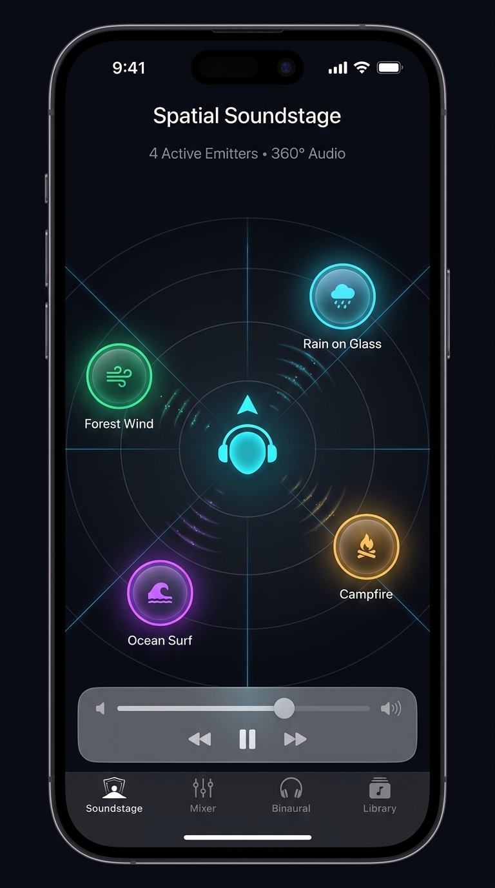
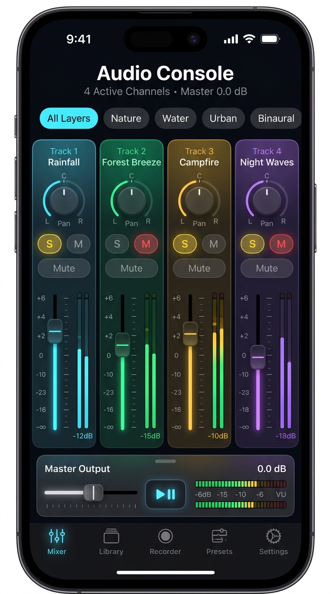
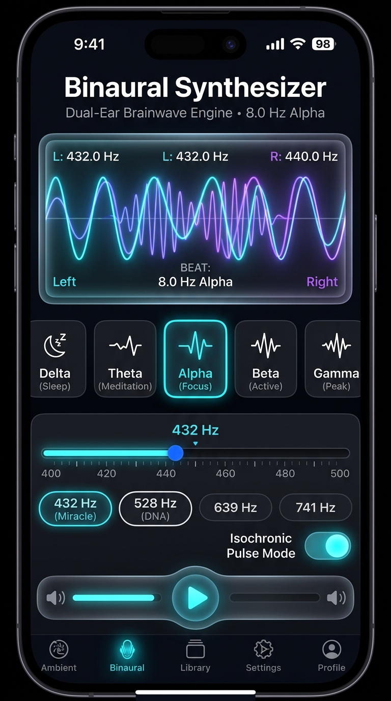

# 🎧 SoundScape Layerer (Custom Binaural & Ambient Mixer)

**SoundScape Layerer** is an ambient sound workstation and procedural binaural beat synthesizer built with Flutter, targeting **iOS** (with background audio capability) and connected to **Supabase** for cloud preset synchronization and community preset discovery.

---

## 📱 App Screenshots

| 2D Spatial Soundstage | Multi-Track Mixer Console | Binaural Beat Synthesizer |
| :---: | :---: | :---: |
|  |  |  |
| *Drag sound nodes in 360° space around the listener avatar* | *Tactile channel strips, dB faders, rotary pan dials & mute/solo* | *Dual-ear phase visualizer, Solfeggio carrier frequencies & brainwave selector* |

---

## 🌟 Key Features

- **🌐 2D Interactive Spatial Soundstage**: Drag ambient sound orbs around a central listener avatar. Distance determines volume attenuation, while horizontal placement calculates stereo panning in real-time.
- **🎛️ Multi-Track Ambient Mixer Console**: Independent volume faders, dB meters, rotary pan dials, mute, and solo matrix for organic audio channels (Rain, Thunder, Ocean Surf, Night Forest, Campfire, Wind Chimes, Café, White/Pink/Brown noise).
- **🧠 Procedural Binaural Beat Synthesizer**:
  - Full brainwave spectrum: **Delta** (0.5–4 Hz), **Theta** (4–8 Hz), **Alpha** (8–14 Hz), **Beta** (14–30 Hz), and **Gamma** (30–50 Hz).
  - Carrier tone adjustment (100 Hz – 963 Hz Solfeggio sacred frequencies).
  - Real-time animated phase visualizer rendering dual-ear waveforms and interference envelopes.
  - Isochronic pulse modulation toggle.
- **📱 iOS First-Class Architecture**:
  - `AVAudioSessionCategoryPlayback` configured in `AppDelegate.swift`.
  - `UIBackgroundModes` `audio` enabled in `Info.plist` for continuous playback when the iPhone screen is locked.
- **⚡ Supabase Backend**:
  - PostgreSQL table with Row-Level Security (RLS) for user presets.
  - Public community soundscape sharing & like counter.
  - Offline-first fallback cache: works seamlessly without active network.
- **⏱️ Smart Sleep Timer**: Smooth logarithmic fade-out automation over the final 60 seconds before playback stops to avoid abrupt waking.
- **💾 Presets & Memory Bank**: Save tailored soundscapes with persistence. Ships with factory presets: *Deep Sleep & Ocean Theta*, *Rainy Café Flow Alpha*, *Campfire Stargaze Delta*, *Gamma Superlearning Lab*.

---

## 🏛️ Architecture Overview

The app follows a clean, reactive architecture powered by `ChangeNotifier` and `Provider`:

```
lib/
├── core/
│   ├── config/          # SupabaseConfig (URL, Anon Key, connection status)
│   ├── constants/       # AppColors, AppTypography, DefaultTracks, FactoryPresets
│   ├── theme/           # Dark futuristic Glassmorphic ThemeData
│   └── utils/           # AudioMath (panning law, dB) & pure Dart WavGenerator
├── models/              # Immutable domain entities (Tracks, Waves, Presets, Spatial)
├── services/
│   ├── audio/           # Multi-track engine, procedural noise & binaural synth
│   ├── storage/         # Preset serialization & persistent storage
│   ├── supabase/        # SupabasePresetService (cloud sync & community presets)
│   └── timer/           # Sleep timer countdown & fade-out automation
├── controllers/         # SoundscapeController, BinauralController, PresetController
├── widgets/
│   ├── common/          # GlassCard, NeonSlider, VolumeKnob, PulsingGlow
│   ├── spatial/         # 2D Soundstage CustomPainter & draggable SoundOrbs
│   ├── mixer/           # Vertical mixer fader strips and category filters
│   ├── binaural/        # Brainwave band rack & phase visualizer
│   ├── presets/         # PresetSelectorSheet (Local + Supabase tabs)
│   └── master/          # Bottom floating playback dock & sleep timer modal
└── views/               # Spatial Stage, Mixer Studio, Binaural Rack, HomeScreen
```

---

## 📱 iOS Setup & Background Playback

The iOS project has already been configured with background audio permissions:

1. **Info.plist**:
   ```xml
   <key>UIBackgroundModes</key>
   <array>
       <string>audio</string>
   </array>
   ```
2. **AppDelegate.swift**:
   Configured with `AVAudioSession.sharedInstance().setCategory(.playback, mode: .default, options: [.mixWithOthers, .allowAirPlay])`.

### Run on iOS Simulator or Device:
```bash
git clone https://github.com/afsalkp007/soundscape_layerer.git
cd soundscape_layerer
flutter pub get
cd ios && pod install && cd ..
flutter run -d ios
```

---

## ⚡ Supabase Setup (Optional Cloud Sync)

1. Open your [Supabase Dashboard](https://supabase.com).
2. Go to the **SQL Editor** and run `supabase/schema.sql`.
3. Provide your Supabase credentials when running the app:
   ```bash
   flutter run -d ios \
     --dart-define=SUPABASE_URL=https://your-project.supabase.co \
     --dart-define=SUPABASE_ANON_KEY=your-anon-key
   ```
*Note: If no Supabase credentials are provided, the app automatically runs in offline-first mode with full local storage persistence and mock community discovery.*

---

## 🧪 Testing

Run the comprehensive unit test suite covering domain models, audio math, wave generators, and controllers:
```bash
flutter test
```

---